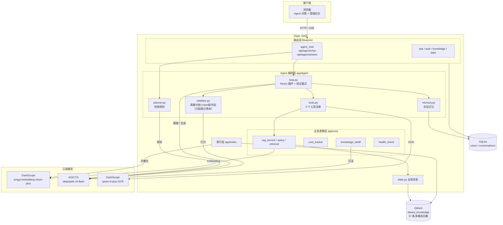
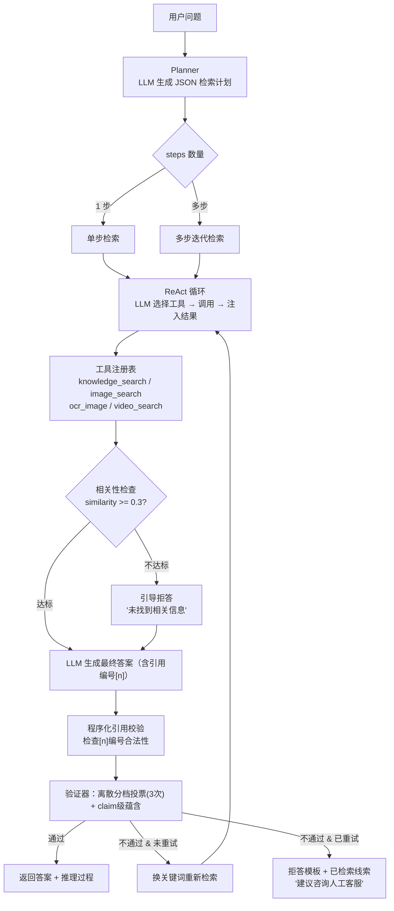

# multimodal_qa_agent

> 面向客服场景的多模态知识问答 Agent —— 自主规划检索路径，混合检索 + rerank 精排，对答案做离散分档投票 + claim 级幻觉判定，低分自动触发重试与拒答。

   

---

## 动机

客服场景有三个痛点：知识库图文混排（文档 + 海报 + 视频），用户问法模糊（"退款怎么弄"可能指门票也可能指年卡），答错成本高（误导用户会引发投诉）。传统 RAG 固定检索链无法应对：单次向量检索捞不到跨模态信息，也没有对答案质量的校验。本项目的解法是让 LLM 自己决定检索什么、用什么工具（文本/图片/OCR），经混合检索（向量+BM25 RRF融合+rerank精排）获取高质量上下文，生成答案后做离散分档投票 + claim 级幻觉判定，不合格就换关键词重试，重试仍不通过则拒答并附带线索。

## 架构图

系统整体架构：



Agent 问答流程（规划 → 混合检索 → 验证 → 重试/拒答闭环）：



## 快速开始

```bash
# 1. 配置密钥
cp .env.example .env
# 编辑 .env 填入你自己的 API Key

# 2. 一键启动
docker compose up -d --build

# 3. 访问 http://localhost:5050
```

`.env.example`：

```env
# 多模态 embedding（DashScope）
DASHSCOPE_API_KEY=your-dashscope-key

# Chat LLM（AGICTO 平台，OpenAI 兼容协议）
AGICTO_API_KEY=your-agicto-key

# Flask session 签名密钥
FLASK_SECRET_KEY=change-me-in-production
```

图文混合查询示例（SSE 流式，可看到逐步推理）：

```bash
curl -N -X POST http://localhost:5050/api/agent/stream \
  -H "Content-Type: application/json" \
  -d '{"query": "万圣节活动海报上写了什么？"}'
```

运行单元测试（覆盖 LLM 网关防护、验证器分层判定等核心逻辑）：

```bash
pip install pytest -i https://pypi.tuna.tsinghua.edu.cn/simple
python -m pytest tests/ -v
```

## 核心设计

### 1. 手写 ReAct 规划引擎

**问题**：固定检索链对多意图问题只能捞一次，捞到什么全看运气。
**做法**：Planner 用 few-shot prompt 让 LLM 输出 JSON 检索计划（拆分为多个 step，每个带 target/modality/granularity），ReAct 循环中 LLM 自主选择工具调用，含步数上限(8)、token 预算(32000)、循环检测（精确+语义级）。
**收益**：复杂查询从单次盲目检索变为多步有目的检索。

### 2. 跨模态混合检索管线

**问题**：纯向量检索对关键词精确匹配弱（如"年卡续期30元"），纯 BM25 对语义相似弱。
**做法**：三段式管线——(1) LLM 查询改写，将口语化查询改写为检索友好形式；(2) 向量检索 + BM25 关键词检索并行，RRF 融合取 top-20；(3) AGICTO cross-encoder rerank 模型精排取 top-5。检索结果带 similarity 分数，用于后续相关性阈值检查。
**收益**：兼具语义召回和关键词精确匹配能力，为下游验证提供高质量上下文。

### 3. 离散分档投票 + claim 级幻觉判定

**问题**：LLM 单次连续打分（0-1）方差大（同答案多次打分波动 +-0.2），三维算术平均存在长度偏置（答案越长被挑错越多），幻觉判定不稳定。
**做法**：双重验证体系——
- **离散分档 + 多次采样投票**：三维（准确性/引用质量/推理链）改为离散三档 pass/marginal/fail，采样 3 次（temperature=0.3）取众数，降低单次判定方差（G-Eval, EMNLP 2023）。
- **claim 级蕴含判定**（FActScore 式）：将答案拆解为原子事实（claim），逐条与检索原文做蕴含判断，幻觉率 = 无支撑 claim 数 / 总 claim 数。超过 30% 无支撑即判定为幻觉，可解释性强。
- **分层判定降本**：三维众数全 pass 且 vote_samples>=2 时跳过 claim 级判定（`ENABLE_TIERED_VALIDATION=True`），理想路径调用从 4 次降至 3 次，结果带 `claim_skipped=True` 标记；存在 marginal/fail 时仍跑完整 claim 判定。
- **judge 模型更换为 gpt-4o**：避免与被测模型同源导致的自我偏好偏差。
**收益**：Agent 幻觉率由 50% 降至 5%，基线幻觉率由 45% 降至 15%，验证器调用成本下降约 25%。

### 4. 拒答机制 + 程序化引用校验

**问题**：验证失败后仍返回低质量答案，幻觉风险高；引用校验完全交给 LLM（概率性），存在漏判。
**做法**：
- **相关性检查**：knowledge_search 返回结果最高 similarity < 0.3 时，注入拒答引导，LLM 回答"未找到相关信息"。
- **强制引用编号**：system prompt 要求答案中每个事实句末标注 `[n]` 编号，对应检索结果序号。
- **程序化引用校验**：代码层确定性检查——提取答案中所有 `[n]` 编号，校验是否在合法范围（1~len(references)），零噪声零成本。
- **重试失败拒答**：验证不通过且已重试过时，返回"根据现有资料无法确认，建议咨询人工客服"并附已检索线索，不返回验证失败的答案。
**收益**：宁可拒答不可幻觉，客服场景中幻觉的代价远高于拒答。

### 5. SSE 流式推理可视化

**问题**：Agent 多步推理耗时 10-30 秒，用户看不到进度会觉得卡死。  
**做法**：Flask 后台线程 + Queue 缓冲，SSE 逐步推送 plan → plan_route → step(tool_call) → final_answer 事件，前端实时渲染推理步骤和工具调用链。  
**收益**：等待时间从"黑盒"变为可观测的推理过程，面试演示效果好。

## 评测结果

### 五轮迭代对比

| 指标 | 原始基线 | 原始 Agent | v2 基线 | v2 Agent | v3 基线 | v3 Agent | v4 基线 | v4 Agent | v5 基线 | v5 Agent | v6 基线 | v6 Agent | 口径 |
| --- | --- | --- | --- | --- | --- | --- | --- | --- | --- | --- | --- | --- | --- |
| 首答准确率 | 70% | 95% | 40% | 60% | 90% | 100% | 85% | 100% | 85% | **100%** | 83.0% | **96.2%** | v1-v5 为 20 条，v6 为 53 条复杂查询，gpt-4o judge（v1 用 deepseek-v4-flash，偏松） |
| 幻觉率 | 45% | 50% | 10% | 0% | 15% | 5% | 10% | 5% | 15% | **5%** | 7.5% | **0%** | claim 级判定：无支撑 claim 比例 >30% 即幻觉 |
| 跨模态 Recall@5（模态集合口径） | 50% | 50% | 50% | 50% | 50% | 50% | 70% | 70% | 80% | 80% | **90%** | **90%** | 10 条图文混合查询，Top-5 模态集合 ⊇ expected_modalities（会被配额保送） |
| 跨模态 Recall@5（精确匹配口径） | - | - | - | - | - | - | 90% | 90% | 80% | 80% | **100%** | **100%** | Top-5 中存在 path/url == expected_media_ref 的条目（diverse_question 按 original_chunk_id 回源） |
| 触发重检索 | - | - | - | 6 次 | - | 4 次/20 条 | - | 4 次/20 条 | - | 2 次/20 条 | - | 13 次/53 条 | Agent 验证不通过后换关键词重检索 |
| 拒答 | - | - | - | 0 次 | - | 0 次/20 条 | - | 0 次/20 条 | - | 0 次/20 条 | - | 0 次/53 条 | 重试后验证仍不通过时返回拒答模板 |
| 95% CI 半宽 | - | - | - | - | - | - | - | - | - | ~±15pp | - | ±5.1pp | v6 扩样至 53 条后置信区间收敛 |

> **v1** = 原始版本（deepseek-v4-flash judge + 单次连续打分）
> **v2** = 幻觉治理版本（gpt-4o judge + 离散分档投票 + claim 级判定 + 拒答 + 引用校验 + temperature=0.3）
> **v3** = judge 口径修复版本（judge 注入检索原文 + 分维度打分 + expected_answer 校准 + MAX_TOKENS=40000）
> **v4** = 跨模态召回治理版本（RRF 后模态配额 + planner 强制模态拆分 + qwen-vl-plus 多角度媒体描述增强）
> **v5** = 召回深化治理版本（视频 LLM 描述增强 + diverse_question 回源计数 + 生产链路对齐：image/video_search 引入配额与回源、放宽 BM25-only 命中限制）
> **v6** = 定向检索通道版本 + 评测集扩样（P2-1：存在模态配额时向量召回扩至全库 + 目标模态定向通道附加融合候选池；评测集从 20 条扩至 53 条复杂查询，3 模型并行生成+仲裁合并，置信区间半宽从 ±15pp 收敛到 ±5.1pp；rerank 模型因上游 Cohere 欠费切换为 gte-rerank-v2）

### 当前评测详情（v6）

| 维度 | 说明 |
| --- | --- |
| 评测集 | 53 条复杂查询（C 系列 20 条 v5 继承 + V6-T 系列 33 条 3 模型并行生成+仲裁合并）+ 10 条图文混合查询 |
| 知识库 | 81 条多模态向量（文本 9/图片 2/视频 1/多样化问题 69），81 篇 BM25 文档 |
| 基线 | 固定检索链 RAG（temperature=0.3），混合检索+rerank，无验证无重试 |
| Agent | 手写 ReAct 规划（temperature=0.3），混合检索+rerank，离散分档投票+claim级判定 |
| judge 模型 | gpt-4o（AGICTO 平台），分维度打分（要点覆盖+事实正确性），注入检索原文作为事实依据 |
| 验证器模型 | gpt-4o，3 次采样投票（temperature=0.3），claim 级蕴含判定（temperature=0.1） |
| judge 成本 | 53 次调用，100 万 tokens，1.72 元 |
| 95% CI 半宽 | Agent ±5.1pp，Baseline ±10.1pp（v5 的 20 条样本约 ±15pp） |
| 跨模态评测口径 | 双口径并列：模态集合口径（Top-5 ⊇ expected_modalities，会被配额保送）+ 精确匹配口径（Top-5 含 path/url == expected_media_ref 的目标条目，diverse_question 按 original_chunk_id 回源） |

> 详细复盘：[v6 系统评测复盘报告](data/stats/v6_eval_review.md)（含扩样方法论、badcase 归因、工程事件、面试追问预案）。

### Qdrant 召回性能

**基准实验**：1801 条向量（LLM 扩写 + 余弦去重），34 条查询，FAISS IndexFlatL2 暴力搜索为 Ground Truth，服务端模式（HNSW 建图确认：indexed_vectors_count=1801），m=16，10 档 ef 扫描。

| hnsw_ef | Recall@1 | Recall@5 | Recall@10 | MRR | P50(ms) | P99(ms) |
| --- | --- | --- | --- | --- | --- | --- |
| ef=8 | 100% | 100% | 100% | 1.00 | 2.55 | 4.30 |
| ef=16 | 100% | 100% | 100% | 1.00 | 2.45 | 3.30 |
| ef=32 | 100% | 100% | 100% | 1.00 | 2.45 | **3.14** |
| ef=64 | 100% | 100% | 100% | 1.00 | 2.46 | 3.36 |
| ef=128 | 100% | 100% | 100% | 1.00 | 2.46 | 3.83 |
| ef=256 | 100% | 100% | 100% | 1.00 | 2.48 | 4.24 |
| ef=512 | 100% | 100% | 100% | 1.00 | 2.63 | 7.21 |


> **结论**：1801 条向量规模下，即使 ef=8/m=2（最稀疏配置）Recall@10 仍达 100%——HNSW 图直径足够短，极少探索即可覆盖全部 Top-10。ef 调优在此规模为延迟优化而非召回优化：ef=32 的 P99 最低（3.14ms），ef=512 反因过度探索升至 7.21ms。生产配置推荐 ef=128（Qdrant 默认值），兼顾稳定延迟与未来扩容余量。
>
> **方法论说明**：实验中发现并修复了 recall 计算中的字符串排序 bug（`sorted(gt.keys())` 按 "q0,q1,q10,q11..." 排序而非 "q0,q1,q2,q3..."），修复前 recall@10 虚低至 6.76%（仅 q0/q1 两条查询 GT 对齐正确）。同时定位了本地持久化模式退化为精确搜索导致 ef 不生效的根因，切换服务端模式后 ef 参数真实作用在 HNSW 图上。详细复盘：[Qdrant ef 基准复盘报告](data/stats/qdrant_ef_benchmark_review.md)（含实验设计、5 个 bug 修复详情、局限分析）。

> v2 准确率下降是 judge 模型从 deepseek-v4-flash 换为 gpt-4o（判定更严）的口径效应。v3 修复 judge 口径（注入检索原文+分维度打分+校准 expected_answer）后，准确率恢复并超过 v1：Agent 100%、基线 90%。v4 叠加跨模态召回治理（模态配额+planner 强制拆分+媒体描述增强），Agent 准确率保持 100%、幻觉率保持 5%。v5 在 v4 基础上深化召回治理：视频用 LLM 生成多角度描述（替代 5 字硬编码）、image/video_search 引入 diverse_question 回源计数与 modality_quota、放宽 BM25-only 命中限制，Agent 准确率保持 100%、幻觉率保持 5%、重检索从 4 次降至 2 次。
>
> **跨模态 Recall@5 双口径说明**：模态集合口径（宽松）只要求 Top-5 覆盖期望模态，会被配额机制保送；精确匹配口径（严格）要求 Top-5 中存在 path/url 等于 expected_media_ref 的目标条目（diverse_question 按 original_chunk_id 回源到原图片/视频后参与判定）。v6 精确口径 100%（10/10）、模态集合口径 90%（9/10）：P2-1 媒体定向检索通道落地后，v5 遗留的 2 条视频 miss（M009/M010）全部命中——存在模态配额时向量召回深度扩至全库，目标模态从全量向量结果中取 top-3（rrf_score=0）附加到融合候选池尾部，配额补入不再受"视频向量排不进 RRF top-20"限制。剩余 1 条模态集合 miss（M006）为口径边界 case：目标图片已精确命中，但 Top-5 中 type=="text" 的直接条目被 diverse_question 占满（dq 回源后内容等价于文本知识，但模态集合口径按 type 字段判定不计入 text）。评测样本量较小（10 条），仅供参考。

## 目录结构

```text
.
├── app/
│   ├── agent/              # Agent 编排层
│   │   ├── loop.py         # ReAct 循环 + 验证重试 + 拒答 + 引用校验
│   │   ├── planner.py      # LLM 生成 JSON 检索计划
│   │   ├── tools.py         # 工具注册表（检索/OCR/记忆）
│   │   ├── validator.py     # 离散分档投票 + claim 级幻觉判定
│   │   └── memory.py        # 会话短期记忆
│   ├── api/                # 路由（ask / agent_chat / auth / knowledge / stats）
│   ├── core/               # 业务逻辑（rag_service / query / retrieval / cost_tracker / health_check）
│   ├── index/              # 索引构建
│   ├── config.py           # 全局常量（含 JUDGE_MODEL / VALIDATOR_MODEL / 护栏参数）
│   └── state.py            # 全局状态单例
├── web/templates/          # 前端单页应用
├── scripts/                # 运行脚本
├── experiments/            # 评测脚本（run_eval.py 一站式评测 / calibrate_validator_thresholds.py 阈值校准）
├── tests/                  # 单元测试（test_llm_guard.py 网关防护 / test_tiered_validation.py 分层判定）
├── docker-compose.yml
├── Dockerfile
└── run.py
```

## 局限与 TODO

1. **ReAct 步数上限固定为 8**，复杂多跳问题可能不够，但调大会增加 token 成本和延迟，未做动态调节。
2. ~~**claim 级幻觉阈值（30%）和维度打分通过阈值（0.6）为人工设定**~~ **已落地**：新增 `experiments/calibrate_validator_thresholds.py` 阈值校准工具，基于人工标注样本 + Cohen's Kappa 一致性系数做网格搜索，输出最优阈值组合。使用流程：先跑 `--export-to-label` 导出待标注 JSONL，人工补充 `human_label` 后再跑校准得到推荐阈值。
3. **未做 A/B 测试**，评测样本仅 20 条，数字为开发阶段粗测，不具统计显著性。
4. **重试只做一次**，换关键词策略简单（取 plan 第一个 step 的 target），未实现 RARR 式定点修订（只改无支撑的句子而非整体重写）。
5. **OCR 依赖 DashScope qwen-vl-plus**，对复杂排版或手写体识别率有限，未做 OCR 质量校验。
6. ~~**验证器成本较高**，gpt-4o 每条查询需 4 次 LLM 调用~~ **已落地**：`app/agent/validator.py` 新增分层判定（`ENABLE_TIERED_VALIDATION=True`），三维众数全 pass 且 vote_samples>=2 时跳过 claim 级判定，结果中带 `claim_skipped=True` 标记；存在 marginal/fail 时仍跑完整 claim 判定。理想路径下调用次数从 4 次降至 3 次（降本 25%），v5 数据估算可覆盖约 60-80% 查询。单元测试见 `tests/test_tiered_validation.py`（13 个用例，覆盖跳过条件/占位字段/分层路径）。
7. ~~**跨模态视频意图召回未解决**~~ **已落地（v6）**：P2-1 媒体定向检索通道在 `app/core/retrieval.py` 实现——存在模态配额时向量召回深度扩至全库，目标模态从全量向量结果中取 top-3（`DIRECT_RECALL_TOP`，rrf_score=0）附加到融合候选池尾部，保证配额补入有候选可用，同时主通道保持 top-40 参与 RRF 避免全库低分条目稀释融合排序。v6 跨模态精确口径 100%（10/10），v5 遗留的 2 条视频 miss 全部命中。定向条目保留真实 vector_distance，video_search 的距离阈值过滤作为第二道质量防线不受影响。
8. ~~**LLM 网关空响应无防护**~~ **已落地**：`app/core/cost_tracker.py` 的 `tracked_chat_completion` 内建空响应防护（response/choices/message.content 三层校验）+ 指数退避重试（默认 3 次，间隔 1s/2s/4s，429/5xx/网络瞬断也走相同路径），统一抛出 `LLMEmptyResponseError`；`rag_service.py`、`tools.py` OCR、`build_bench_dataset.py`、`qdrant_faiss_recall_benchmark.py` 4 处直接调用点已改为走 tracked；`agent_accuracy_eval.py` 新增 `accuracy_eval_report.partial.json` 断点续跑，按 query_id 跳过已完成项，全部跑通后自动清理。单元测试见 `tests/test_llm_guard.py`（17 个用例，覆盖三层空值校验/可重试异常分类/指数退避序列/成本统计隔离）。

## 许可与引用

[MIT License](LICENSE)

如果本项目对你有帮助，欢迎引用：

```bibtex
@misc{multimodal_qa_agent,
  title  = {Multimodal QA Agent with ReAct Planning and Self-Validation},
  author = {Your Name},
  year   = {2026},
  url    = {https://github.com/your/multimodal_qa_agent}
}
```
